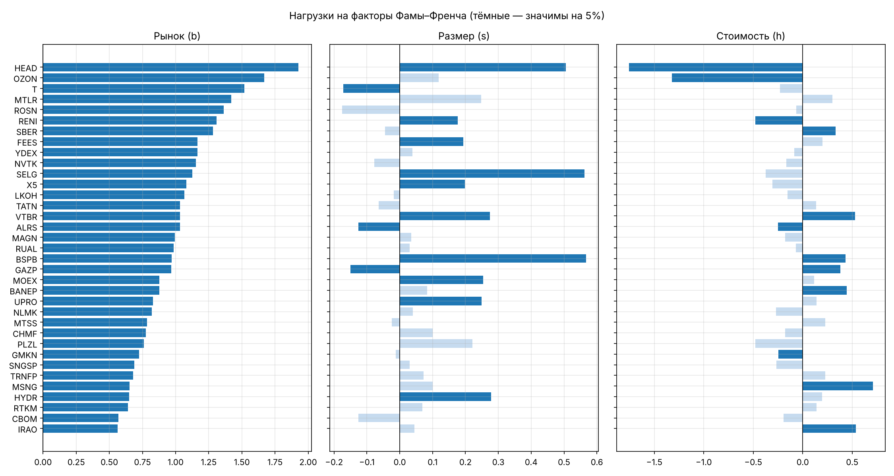
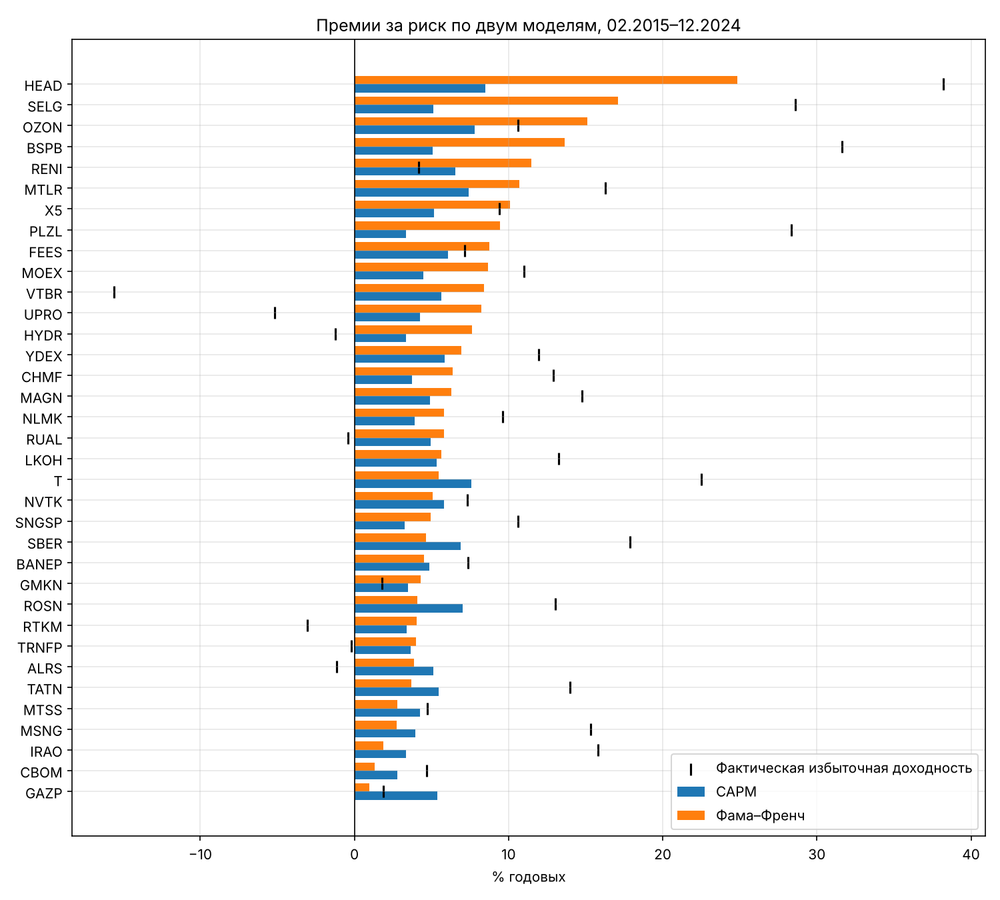

## Резюме

Добавление факторов размера (SMB) и стоимости (HML) к рыночному фактору повышает долю объяснённой дисперсии доходностей 35 российских акций с 38% до 42% и снижает среднюю ошибку ценообразования с 9,8 до 8,1 п.п. годовых (02.2015–12.2024, 119 месяцев).

- **Рынок.** Беты от 0,55 (CBOM) до 1,66 (HEAD), все значимы. Премия рынка над RUONIA — 5,1% годовых, статистически незначима (t = 0,8).
- **Размер и стоимость.** Значимая нагрузка на SMB — у 13 акций, на HML — у 12. Знаки экономически осмысленны: малые банки и энергетика ведут себя как малые компании, банки и энергетика — как «акции стоимости», IT — как «акции роста».
- **«Альфа» по CAPM часто ложная.** У BSPB альфа по CAPM +26,6% годовых (t = 2,6), в модели Фамы–Френча +18,0% и незначима: часть доходности — плата за размер и стоимость.
- **Премии за риск.** Для малых компаний CAPM занижает премию на 7–16 п.п. (HEAD, SELG, BSPB, OZON), для крупных — слегка завышает (до 4,4 п.п. у GAZP).
- **Тест GRS** отвергает обе модели на 5% (p = 0,015 и 0,037), трёхфакторная ближе к цели. Выводы устойчивы к выбору безрисковой ставки, учёту дивидендов и периоду.
- **Рекомендация.** Для крупных бумаг достаточно CAPM; для малых и бумаг с выраженным профилем роста/стоимости стоимость капитала нужно считать по модели Фамы–Френча от текущей ставки ОФЗ (13,72% на 30.09.2026).

## 1. Выборка и данные

Выборка — 35 акций Мосбиржи: 15 бумаг из ДЗ1 и 20 крупнейших по капитализации и ликвидности. Разброс по размеру и оценке нужен, чтобы факторы SMB и HML могли проявиться. Общее у всех бумаг: одна площадка (режим TQBR), рубли, входят или входили в индекс Мосбиржи; различаются отрасль, размер, B/M, дивидендная политика и доля государства.

| Отрасль | Акции | Профиль |
|---|---|---|
| Нефть и газ | LKOH, ROSN, GAZP, NVTK, TATN, SNGSP, BANEP, TRNFP | Крупные, дивидендные |
| Финансы | SBER, VTBR, T, MOEX, BSPB, CBOM, RENI | От гигантов до малых банков |
| Металлы и добыча | GMKN, PLZL, CHMF, NLMK, MAGN, RUAL, ALRS, SELG, MTLR | Экспортёры, сырьевой цикл |
| Электроэнергетика | IRAO, HYDR, FEES, UPRO, MSNG | Регулируемые, малая капитализация |
| Телеком и IT | MTSS, RTKM, YDEX, HEAD | IT — «рост», телеком — «защита» |
| Потребсектор | OZON, X5 | Рост, e-commerce |

**Источники.** Цены и индексы IMOEX, MCFTR — Мосбиржа (ISS API), 01.2015–09.2026; дивиденды — dohod.ru со сверкой на smart-lab.ru; RUONIA и кривая ОФЗ — Банк России; факторы SMB, HML, MOM, LIQ — проект CAPM-RU ИПЭИ РАНХиГС (А.Е. Абрамов, aea.ru), данные по 12.2024. Поэтому основной период — 02.2015–12.2024.

**Полная доходность.** R = (P~t~ + D~t~) / P~t−1~ − 1; дивиденд относится к месяцу экс-даты (T+2, с 31.07.2023 — T+1). Дивиденды дают до 11–12% годовых (MTSS, SNGSP), без них доходность занижена. Сплиты уже учтены биржей; тикеры склеены (YNDX→YDEX, FIVE→X5, HHRU→HEAD), 8 месяцев без торгов X5 исключены.

**Безрисковая ставка — RUONIA за каждый месяц** (в среднем 0,79% в месяц, всегда больше нуля). Ставка РАНХиГС — изменение ценового индекса ОФЗ RGBI — отрицательна в 56 месяцах из 119 (февраль 2022 г.: −15,9%), поэтому не используется. Проверка устойчивости — доходность 3-месячных ОФЗ на конец предыдущего месяца.

**Факторы.** MKT = MCFTR − RUONIA (строим сами, чтобы ставка была одна везде); SMB и HML — РАНХиГС с дивидендами (в портфелях «лонг минус шорт» ставка сокращается).

| Фактор | Среднее, % год. | t-стат. | Вывод |
|---|---|---|---|
| MKT | 5,1 | 0,8 | Незначима: высокие ставки и 2022 г. |
| SMB | 17,9 | 2,2 | Значима, но во многом за счёт 2023 г. (+137%) |
| HML | −3,4 | −0,7 | «Стоимость» не обогнала «рост» |

Корреляции факторов по модулю не выше 0,24 — мультиколлинеарности нет.

## 2. Методология

Оценка идёт в четыре шага; все расчёты — в Python (pandas, statsmodels, scipy), ноутбук `hw2_fama_french.ipynb`.

1. **Временные регрессии** по каждой акции (МНК, месячные данные, минимум 36 наблюдений, ошибки Ньюи–Уэста с 3 лагами).
2. **Сравнение моделей:** R² и скорректированный R², средний модуль α, число значимых α, совместный тест GRS (Gibbons, Ross, Shanken, 1989) на 27 акциях с полной историей.
3. **Процедура Фамы–Макбета (1973):** 119 поперечных регрессий доходностей на беты, цена риска λ — среднее по месяцам.
4. **Премии за риск:** Σ β·λ, где λ — средняя доходность фактора; требуемая доходность = текущая ставка 1-летних ОФЗ (13,72% на 30.09.2026) + премия.

CAPM: $R_{i,t} - r_{f,t} = \alpha_i + \beta_i\,MKT_t + \varepsilon_{i,t}$

Фама–Френч: $R_{i,t} - r_{f,t} = \alpha_i + b_i\,MKT_t + s_i\,SMB_t + h_i\,HML_t + \varepsilon_{i,t}$

Если модель верна, α = 0: факторы полностью объясняют среднюю избыточную доходность акции.

## 3. Результаты: CAPM против Фамы–Френча

Трёхфакторная модель объясняет доходности лучше CAPM по всем мерам, но тест GRS формально отвергает обе.

| Показатель | CAPM | Фама–Френч |
|---|---|---|
| Средний R² | 0,380 | 0,423 |
| Средний скорр. R² | 0,374 | 0,406 |
| Средний модуль α, % год. | 9,8 | 8,1 |
| Значимых α (5%) | 3 | 3 |
| GRS (p-value) | 1,86 (0,015) | 1,68 (0,037) |

**CAPM.** Все беты значимы. Выше рынка — компании роста и крупнейшие банки/нефтяники (HEAD 1,66; OZON 1,53; T 1,49; MTLR 1,45; ROSN 1,37; SBER 1,35), ниже — «защитные» (CBOM 0,55; SNGSP 0,64; PLZL, IRAO 0,65; HYDR, RTKM 0,66). Значимые альфы — только у BSPB (+26,6%), HEAD (+36,2%) и VTBR (−21,2% годовых).

**Фама–Френч.** Рыночные беты почти не меняются (средняя ~1,0). Значимые нагрузки:

| Нагрузка | Число акций | Кто |
|---|---|---|
| SMB > 0 (как малые) | 10 | BSPB, SELG, HEAD, HYDR, VTBR, MOEX, UPRO, X5, FEES, RENI |
| SMB < 0 (как крупные) | 3 | GAZP, ALRS, T |
| HML > 0 («стоимость») | 7 | BSPB, VTBR, SBER, MSNG, IRAO, BANEP, GAZP |
| HML < 0 («рост») | 5 | HEAD, OZON, RENI, GMKN, ALRS |

{width=100%}

**«Альфа» по CAPM — часто премия за размер и стоимость** (как в примере со слайда 70 лекции 3). BSPB: +26,6% (t = 2,6) → +18,0% (t = 1,9); HEAD: +36,2% (t = 2,1) → +9,7% (t = 0,6). У VTBR альфа остаётся (−24,0%, t = −4,0): размывание при допэмиссиях 2022–2025 гг. — специфический риск. В модели ФФ значимая положительная альфа только у SBER (+13,3%, t = 1,99), отрицательные — у VTBR и UPRO.

**Фама–Макбет.** Константы ≈ 0, знаки λ совпадают со средними доходностями факторов (MKT 11,6%, SMB 20,7%, HML −7,7% годовых), но все незначимы (модуль t ≤ 1,54): 35 акций и 10 лет волатильного рынка недостаточно для точной оценки цены риска.

## 4. Премии за риск и требуемая доходность

Для малых компаний CAPM занижает премию за риск на 7–16 п.п., для крупных — завышает на 0–4 п.п. Премия = Σ β·λ; λ — средние доходности факторов за 2015–2024 (MKT 5,1%, SMB 17,9%, HML −3,4% годовых).

{width=80%}

Требуемая доходность считается на дату анализа: безрисковая ставка — доходность 1-летних ОФЗ на 30.09.2026, 13,72%.

| Акция | CAPM, % | Фама–Френч, % | Разница, п.п. | Факт. изб. доходность 2015–24, % |
|---|---|---|---|---|
| HEAD | 22,2 | 38,5 | +16,3 | 38,2 |
| SELG | 18,9 | 30,8 | +11,9 | 28,6 |
| BSPB | 18,8 | 27,4 | +8,6 | 31,6 |
| OZON | 21,5 | 28,8 | +7,3 | 10,6 |
| X5 | 18,9 | 23,8 | +4,9 | 9,4 |
| LKOH | 19,0 | 19,4 | +0,3 | 13,2 |
| SBER | 20,6 | 18,4 | −2,3 | 17,9 |
| ROSN | 20,7 | 17,8 | −2,9 | 13,0 |
| GAZP | 19,1 | 14,7 | −4,4 | 1,9 |

Оговорка: премия SMB во многом держится на 2023 г., а премия рынка незначима — для прогноза премии стоит брать консервативнее исторических.

## 5. Устойчивость, дополнительные факторы и альтернативные модели

Во всех проверках Фама–Френч объясняет доходности лучше CAPM, а выбор безрисковой ставки почти не влияет на выводы.

| Вариант | R² CAPM | R² ФФ | Ср. модуль α CAPM, % | Ср. модуль α ФФ, % |
|---|---|---|---|---|
| Основной (RUONIA, с дивидендами) | 0,38 | 0,42 | 9,8 | 8,1 |
| rf = ОФЗ 3 мес. | 0,38 | 0,42 | 9,7 | 8,1 |
| Без дивидендов (IMOEX) | 0,36 | 0,41 | 11,3 | 9,6 |
| Рыночный фактор РАНХиГС | 0,29 | 0,34 | 13,5 | 12,3 |
| CAPM на 02.2015–09.2026 | 0,38 | — | 8,4 | — |

**Дополнительные факторы (вопрос 4 задания).** Моментум MOM (Carhart, 1997) и ликвидность LIQ (Amihud, 2002; Pástor, Stambaugh, 2003) проверены на данных РАНХиГС: скорректированный R² растёт лишь с 0,406 до 0,413, MOM значим у 4 акций, LIQ — у 2. Другие кандидаты из литературы: прибыльность RMW и инвестиции CMA (Fama, French, 2015); макрофакторы по Chen, Roll, Ross (1986) — для России прежде всего цена нефти и курс рубля; фактор госсобственности SOE (CAPM-RU).

**Альтернативные модели (вопрос 5).**

| Модель | Идея | Чем улучшит наш результат |
|---|---|---|
| Пятифакторная ФФ (2015) | + RMW, CMA | Может объяснить отрицательные альфы VTBR и UPRO |
| q-модель (Hou, Xue, Zhang, 2015) | Инвестиции и ROE из теории производства | Экономически обоснованная альтернатива ФФ5 |
| Условная CAPM (Jagannathan, Wang, 1996) | Беты меняются во времени | Учёт слома 2022 г. |
| Макро-APT (Ross, 1976) | Нефть, рубль, ключевая ставка | «Плохие времена» сырьевой экономики |

## 6. Рекомендации

1. **Крупные ликвидные бумаги** (SBER, LKOH, ROSN, TATN, NVTK, GAZP, MTSS): достаточно CAPM — она даёт близкую или чуть завышенную (на 0–4 п.п.) стоимость капитала.
2. **Малые компании и бумаги роста/стоимости** (BSPB, SELG, HEAD, OZON, X5, HYDR, UPRO): стоимость капитала по модели Фамы–Френча, иначе она занижена на 4–16 п.п. — прямая ошибка в DCF-оценке.
3. **Альфу управляющего или инвестидеи проверять многофакторной моделью:** «альфа» BSPB и HEAD по CAPM во многом оказалась премией за размер и стоимость.
4. **Портфель:** SBER — единственная значимая положительная альфа в модели ФФ (+13,3%, на границе значимости) — кандидат на перевес; VTBR и UPRO с отрицательной альфой — недовешивать.
5. **Защитный портфель** — низкая β (CBOM, SNGSP, TRNFP, IRAO, RTKM, PLZL); ставка на рост рынка — высокая β (HEAD, OZON, T, ROSN, SBER). Требуемую доходность считать от текущей ставки ОФЗ, премию за размер — консервативнее исторической.

## 7. Ограничения

| Слабое место | Чем грозит | Как исправить |
|---|---|---|
| Факторы РАНХиГС только до 12.2024 | 2025–2026 гг. не вошли в модель ФФ | Построить SMB и HML самим по данным биржи и отчётности |
| Отдельные акции, а не портфели | Шумные беты, Фама–Макбет незначим | Тестовые портфели размер × B/M, поправка Шанкена |
| Неустойчивые премии факторов | SMB держится на 2023 г., премия рынка незначима | Длинный ряд с 2003 г., консервативные премии |
| Структурный слом 2022 г. | Беты считаются постоянными | Подвыборки до/после 2022, скользящие беты |
| Короткая история RENI, OZON, HEAD, T, X5 (38–74 мес.) | Менее надёжные оценки | Читать с осторожностью, расширять по мере накопления данных |
| Разные источники данных | Дивиденды с dohod.ru; выборка РАНХиГС ≠ наш рынок | Сверка с НРД, единая методика факторов |

## 8. Заключение

Размер и стоимость — реальные источники систематического риска на российском рынке: они повышают объяснённую дисперсию с 38% до 42%, значимы у трети выборки и меняют премию за риск малых компаний до 16 п.п. Тест GRS отвергает обе модели, но трёхфакторная заметно ближе к цели; выводы устойчивы к ставке, дивидендам и периоду. Моментум и ликвидность добавляют немного.

Расчёты: ноутбук `hw2_fama_french.ipynb`, таблицы `results/hw2_results.xlsx`.
